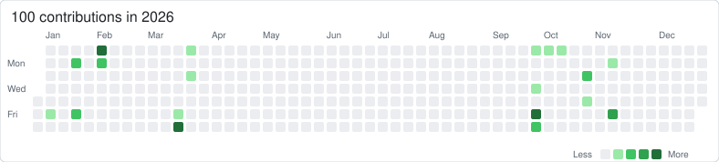

# Michael ESSOMBA

### Final-year Embedded Systems & Robotics Engineering Student @ ENSIM

**Embedded software · Robotics · Electronics · Hardware validation**

**Seeking a 6-month final-year engineering internship from March 2027 · Mobility: France**

[LinkedIn](https://www.linkedin.com/in/essomba-michael-84b12643b/) · [Email](mailto:Michael.Essomba_Jabe.Etu@univ-lemans.fr)

## About me

Final-year engineering student at **ENSIM – Le Mans University**, specializing in **Embedded and Intelligent Systems**.

I develop software that interacts with real hardware: sensors, actuators, microcontrollers and test equipment. My projects combine **C/Python development, hardware integration, automated testing and technical documentation**.

## Technical skills

| Area | Technologies and methods |
|---|---|
| **Embedded software** | C · STM32 · PIC16 · GPIO · ADC · PWM · UART · Interrupts · State machines |
| **Robotics & control** | Mecanum kinematics · Encoders · Odometry · PID fundamentals · Raspberry Pi · Python |
| **Instrumentation & validation** | LabVIEW · LabWindows/CVI · VISA/SCPI · TCP/IP · Python test campaigns · CSV analysis |
| **Electronics & digital design** | KiCad · VHDL · Quartus Prime · ModelSim · Cyclone V / DE10-Standard · SolidWorks |
| **Currently learning / integrating** | FreeRTOS · CAN · ROS 2 |

## Selected projects

### 🤖 TopoBot — Topographic robot prototype

**Team project — ENSIM × ESGT · 2025–2026**

A Mecanum robot designed to move a reflector across a measurement grid for topographic surface measurements.

**My contribution:** Mecanum kinematics and movement commands, physical robot testing, encoder/odometry integration, motion-error analysis and AX-12 prism deployment.

**Status:** basic movements and prism deployment validated; motion accuracy and closed-loop tuning remain to be improved.

`STM32 F446RE` · `Raspberry Pi` · `C` · `Python` · `Encoders` · `AX-12` · `XBee`

[**Code, architecture and documentation →**](https://github.com/Mickael235/topobot)

### 🔬 FIATSAR — Embedded TinyML robustness

**Final-year research project · Team of two · In progress**

Evaluation of a small speech-command recognition model under noise, with deployment and validation on **Arduino Nano 33 BLE Sense**.

**My contribution:** TensorFlow Lite Micro deployment, model compatibility and quantization work, Python PC-to-board test campaigns, serial communication, latency and memory measurements. Literature review and interpretation are shared with my teammate, who leads model training and perturbation studies.

**Validated milestone:** identical PC/board predictions on a fixed nominal batch of **500 inputs**, with **75.2% classification accuracy** and approximately **83 ms per inference** on the board. Agreement between platforms is distinct from classification accuracy.

**Next steps:** complete noisy-input campaigns after a serial synchronization issue, and extend adversarial evaluation. Results reflect the project review of 10 November 2026.

`Python` · `TensorFlow Lite Micro` · `INT8` · `Arduino` · `Serial communication` · `CSV`

## Other projects

| Project | Scope and status | Stack |
|---|---|---|
| [**Automated Instrumentation Platform**](https://github.com/Mickael235/automated-instrumentation-platform) | Automated frequency sweeps, gain measurements and cutoff estimation | LabVIEW · CVI · C · VISA/SCPI · TCP/IP |
| [**FPGA / VHDL Digital Systems**](https://github.com/Mickael235/fpga-vhdl-digital-systems) | Adders, counters, registers and display decoding with hardware validation | VHDL · Quartus · ModelSim · DE10-Standard |
| [**PIC16F1719 Temperature Monitoring**](https://github.com/Mickael235/pic16f1719-temperature-control) | TMP36 acquisition, averaging, configurable threshold, LCD feedback and PWM alarm | Embedded C · ADC · PWM |
| [**STM32 Smart Lighting System**](https://github.com/Mickael235/stm32-smart-lighting-system) | PIR sensing, LDR acquisition and servo control; integration issues documented | STM32 · C · ADC · PWM · UART |
| [**Distributed STM32 Motor Control**](https://github.com/Mickael235/stm32-distributed-motor-control) | In development — targeting closed-loop control, CAN telemetry and fault handling | STM32 · FreeRTOS · CAN · PID |

## Education & activities

- **ENSIM – Le Mans University** — Final-year engineering student, Embedded and Intelligent Systems.
- **ENSIMelec** — Member of ENSIM's robotics team, Coupe de France de Robotique.
- **Robotic-arm digital twin** — Ongoing project exploring simulation, kinematics and motion control; ROS 2 integration in progress.

## Contact

Available from **March 2027** for a **6-month internship** in embedded software, robotics, electronics or validation/test engineering.

[**LinkedIn**](https://www.linkedin.com/in/essomba-michael-84b12643b/) · [**Email**](mailto:Michael.Essomba_Jabe.Etu@univ-lemans.fr)

<b>GitHub activity — 2026 / 2025</b>

