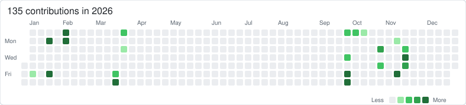
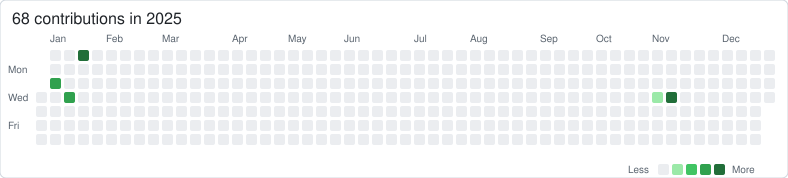

# Michael ESSOMBA

### Final-year Engineering Student · Embedded Systems & Robotics · ENSIM

**Embedded C/C++ · Robotics · Electronics & FPGA · Instrumentation · TinyML**

**Looking for a 6-month final-year engineering internship from March 2027 · Available across France**

## About me

I am a final-year engineering student at **ENSIM – Le Mans University**, specializing in **Embedded and Intelligent Systems (ISIE)**.

I enjoy building and testing systems at the interface of **software and physical hardware**: microcontrollers, sensors, actuators, mobile robots and laboratory instruments. My work combines **C/C++ and Python programming, electronics, simulation, integration and experimental validation**.

My portfolio includes academic and collaborative projects. Each repository describes **my contribution, what was actually tested, and what remains to be completed**.

## Technical skills

| Domain | Technologies and methods |
|---|---|
| **Embedded software & IoT** | C · C++ (Arduino) · STM32 / HAL · PIC16 · GPIO · ADC · PWM · UART · Interrupts · XBee / IEEE 802.15.4 |
| **Robotics & simulation** | Mecanum kinematics · Encoder feedback · Raspberry Pi · Python · CoppeliaSim / Lua · Motion control fundamentals |
| **Electronics & FPGA** | KiCad · Schematics & PCB routing · SolidWorks · VHDL · Quartus Prime · ModelSim · Cyclone V / DE10-Standard |
| **Instrumentation & validation** | LabVIEW · LabWindows/CVI · VISA / SCPI · GPIB · TCP/IP · Automated measurements · Python / CSV analysis |
| **Embedded AI** | Python · TensorFlow Lite Micro · INT8 quantization · PyTorch · Experiment design |
| **Learning / ongoing work** | ROS 2 · FreeRTOS · CAN |

## Featured projects

<!-- All featured images below are stored in the linked project repositories. -->

| **Robotics & Automation** | **TinyML & Embedded AI** |
|:---|:---|
|  |  |
| **[TopoBot — Topographic Robot](https://github.com/Mickael235/topobot)** Mobile robot using Mecanum wheels, STM32 and Raspberry Pi. **My work:** motion commands and kinematics, hardware testing, encoder/odometry integration and motion-error analysis. **Status:** basic movements tested; autonomous survey accuracy not yet demonstrated. `C` `Python` `STM32` `Raspberry Pi` | **[FIATSAR — TinyML Robustness](https://github.com/Mickael235/FIATSAR-TinyML-Robustness)** Speech-command model deployed on Arduino Nano 33 BLE Sense. **My work:** INT8 deployment, model compatibility, PC–board serial testing, timing and memory measurements. **Status:** 500 nominal inputs checked; noise and robustness studies ongoing. `Python` `TFLite Micro` `Arduino` `INT8` |

| **Electronics & PCB Design** | **Robotic Simulation** |
|:---|:---|
|  |  **[▶ Watch the demo on LinkedIn](https://www.linkedin.com/feed/update/urn:li:activity:7521463799107735553/)** |
| **[PIC16 Biometric Access Control](https://github.com/Mickael235/pic16-biometric-access-control)** Digital design of an access-control PCB: electronic schematic, PCB routing and mechanical enclosure model. **Status:** KiCad / SolidWorks design completed; PCB not physically manufactured. `PIC16F88` `KiCad` `RS232` `SolidWorks` | **[CoppeliaSim — Pick-and-Place Cell](https://github.com/Mickael235/coppeliasim-pick-and-place)** ABB IRB 140, RG2 gripper, conveyor, detection, robot motion and dashboard. **My work:** scenario integration, sequencing and virtual testing. **Status:** three cycles observed in simulation; clean-install reproducibility remains to be checked. No ROS 2 integration in this scene. `CoppeliaSim` `Lua` `Simulation` |

| **Instrumentation & Test Automation** | **Digital Electronics & FPGA** |
|:---|:---|
|  |  |
| **[Automated Instrumentation Platform](https://github.com/Mickael235/automated-instrumentation-platform)** Automated RC-circuit frequency sweeps, gain calculations and Bode plots, including a C client–server implementation. `LabVIEW` `LabWindows/CVI` `C` `VISA/SCPI` `TCP/IP` | **[FPGA / VHDL Digital Systems](https://github.com/Mickael235/fpga-vhdl-digital-systems)** Design, simulation, synthesis and hardware testing of multiplexers, arithmetic circuits, registers and counters. `VHDL` `ModelSim` `Quartus Prime` `Cyclone V` |

## Explore projects by domain

### 🤖 Robotics & Automation

| Project | Focus |
|---|---|
| [TopoBot](https://github.com/Mickael235/topobot) | Physical Mecanum robot, STM32 control and motion-validation experiments |
| [CoppeliaSim Pick-and-Place](https://github.com/Mickael235/coppeliasim-pick-and-place) | Robotic cell simulation, sequential control and virtual testing |
| [Distributed STM32 Motor Control](https://github.com/Mickael235/stm32-distributed-motor-control) | **In specification phase** — proposed FreeRTOS, CAN and PID-based architecture; implementation not yet validated |

### ⚙️ Embedded Systems & IoT

| Project | Focus |
|---|---|
| [STM32 Smart Lighting](https://github.com/Mickael235/stm32-smart-lighting-system) | STM32 HAL, PIR, LDR/ADC, servo/PWM and UART; individual functions tested, full integration unfinished |
| [XBee Wireless Sensor Network](https://github.com/Mickael235/xbee-wireless-sensor-network) | Co-developed central Arduino HUB, message parsing and IEEE 802.15.4 radio links (**not** ZigBee mesh) |
| [PIC16F1719 Temperature Control](https://github.com/Mickael235/pic16f1719-temperature-control) | Embedded C, TMP36 acquisition, ADC, LCD feedback and PWM alarm |
| [FIATSAR TinyML Robustness](https://github.com/Mickael235/FIATSAR-TinyML-Robustness) | Microcontroller deployment, serial testing and robustness evaluation |

### 🔌 Electronics & FPGA Design

| Project | Focus |
|---|---|
| [PIC16 Biometric Access Control](https://github.com/Mickael235/pic16-biometric-access-control) | KiCad schematics and PCB layout, RS232 and SolidWorks enclosure; **digital prototype only** |
| [FPGA / VHDL Digital Systems](https://github.com/Mickael235/fpga-vhdl-digital-systems) | Digital circuits simulated and tested on DE10-Standard hardware |

### 📡 Instrumentation & Digital Communications

| Project | Focus |
|---|---|
| [Automated Instrumentation Platform](https://github.com/Mickael235/automated-instrumentation-platform) | LabVIEW and LabWindows/CVI measurement automation with VISA/GPIB and TCP/IP |
| [Information Theory & Digital Communications](https://github.com/Mickael235/michael-essomba-theorie-information) | MATLAB/Simulink, source coding, Hamming coding, QPSK and pulse shaping |

### 🧠 Artificial Intelligence & Software

| Project | Focus |
|---|---|
| [Othello Neural Network Player](https://github.com/Mickael235/othello-nn-player) | PyTorch MLP, LSTM and CNN models trained to predict human moves; evaluation and tuning |
| [FIATSAR TinyML Robustness](https://github.com/Mickael235/FIATSAR-TinyML-Robustness) | Embedded inference, quantization and controlled testing |
| [24 Heures du Code — Covéa](https://github.com/Mickael235/24HduCode_3026_covea) | Team coding challenge; documentation being expanded |

## Education & activities

- **ENSIM – Le Mans University** — Final-year engineering student, Embedded and Intelligent Systems (ISIE).
- **ENSIMelec** — Robotics team member, Coupe de France de Robotique.
- **Robotic-arm digital twin** — Ongoing exploration of robotic simulation and motion control; ROS 2 integration is a separate work in progress.

## Let's connect

I am looking for a **6-month engineering internship beginning in March 2027** in **embedded software, robotics, electronics, instrumentation or hardware/software validation**. I am mobile throughout France.

[**LinkedIn**](https://www.linkedin.com/in/essomba-michael-84b12643b/) · [**Portfolio**](https://michael-essomba-portfolio.vercel.app/) · [**Email**](mailto:Michael.Essomba_Jabe.Etu@univ-lemans.fr)

<b>GitHub activity — 2025 / 2026</b>

